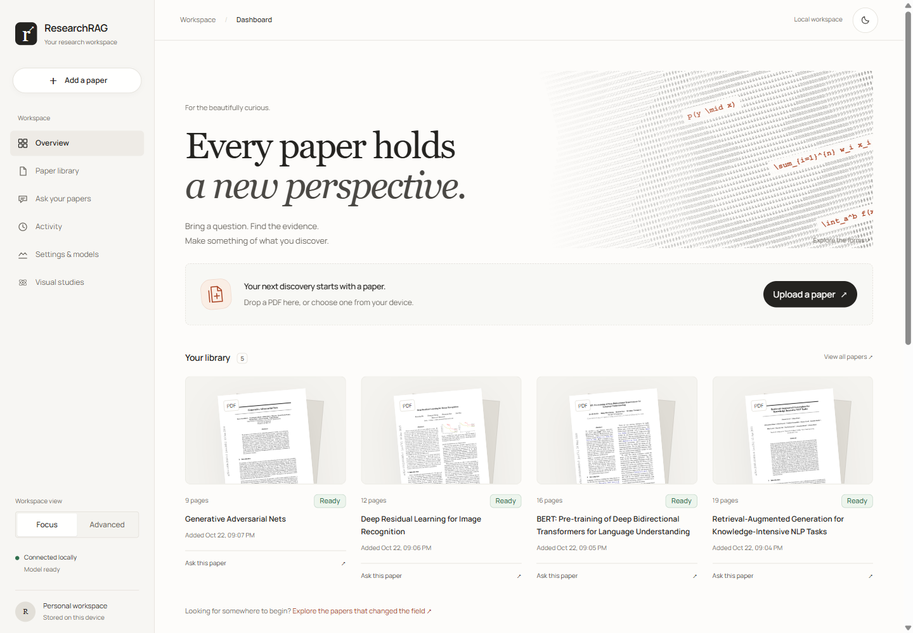
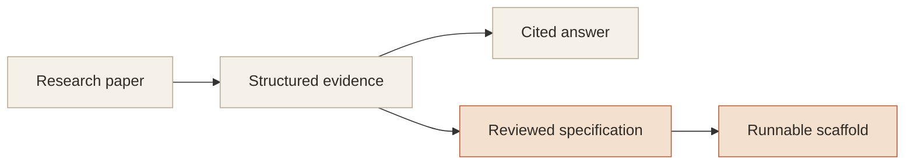

# ResearchRAG

**Read the paper. Follow the evidence. Build something from it.**

ResearchRAG is a local workspace for the beautifully curious. Bring a research paper, ask it a question, and follow the answer back to the original page. When you are ready to build, turn those passages into a reviewable specification and a runnable implementation scaffold.

Start with source excerpts, connect your own API key, or run a small model on your CPU. Your papers and indexes live on your computer.

[](https://github.com/aryan-astra/ResearchRag/actions/workflows/checks.yml) [](pyproject.toml) [](frontend/package.json) [](LICENSE)

[Get started](#get-started) · [The workspace](#a-little-less-searching-a-little-more-understanding) · [Answer modes](#choose-how-you-want-to-ask) · [Under the paper](#under-the-paper) · [Documentation](#keep-exploring)

## A little less searching. A little more understanding.

<picture>
  <source media="(prefers-color-scheme: dark)" srcset="assets/screenshots/workspace-dark.png">
  
</picture>

*The real workspace, shown with classic research papers. Light and dark themes share the same warm, quiet reading space.*

| Read closely | Ask with context | Build with evidence |
| --- | --- | --- |
| Inspect pages, sections, figures, tables, and extracted equation text. Keep the original PDF page within reach. | Search with semantic and keyword retrieval. Open the cited passages behind an answer. | Review quoted requirements, generate a scaffold, run checks, and compare reported metrics. |

## Get started

You need **Python 3.11+**, **Node.js 22.12+**, and Git. Python 3.11 is the version used by CI with the pinned dependency lock. An API key and GPU are optional.

<details open>
<summary><strong>Windows · PowerShell</strong></summary>

Open PowerShell where you want the project, then run:

```powershell
git clone https://github.com/aryan-astra/ResearchRag.git
cd ResearchRag
python -m venv .venv
.venv\Scripts\python.exe -m pip install -r requirements-dev.lock
.venv\Scripts\python.exe -m pip install --no-deps -e .
cd frontend
npm ci
npm run build
cd ..
.venv\Scripts\researchrag.exe serve
```

The commands use the environment directly; activating it is not required.

</details>

<details>
<summary><strong>macOS / Linux · Terminal</strong></summary>

```bash
git clone https://github.com/aryan-astra/ResearchRag.git
cd ResearchRag
python3 -m venv .venv
.venv/bin/python -m pip install -r requirements-dev.lock
.venv/bin/python -m pip install --no-deps -e .
cd frontend
npm ci
npm run build
cd ..
.venv/bin/researchrag serve
```

</details>

Open **[localhost:8000](http://127.0.0.1:8000/)**. Keep the terminal open while you use the app; press **Ctrl+C** to stop it. If you already have the checkout, start at the environment-creation step.

The first setup needs internet for dependencies and, normally, the semantic search models. Once cached, local search and excerpts can work offline. If a model download fails, the app can fall back to lightweight hashing retrieval; inspect **Settings & models** to see what is active.

### Your first paper

1. **Bring a paper.** Upload a PDF, or open the paper library and import a classic such as *Attention Is All You Need*, BERT, or the original RAG paper. Classic-paper imports need internet.
2. **Ask something specific.** Try “What problem does this paper solve?” or “Which training settings does it report?”
3. **Follow the source.** Open a citation, inspect the passage and original page, then ask a better question.

The bundled PDF at [`data/samples/rag_paper.pdf`](data/samples/rag_paper.pdf) is another starting point. No model key is needed for source excerpts.

## Choose how you want to ask

| Mode | What you need | Good for |
| --- | --- | --- |
| **Offline excerpts** | No API key or generative-model download | Finding and reading relevant source passages with citations. |
| **Your API key** | A supported provider key, entered in the answer controls | Generative answers using Groq, Gemini, or an OpenAI-compatible provider. Provider limits and costs apply. |
| **Local AI** | A compatible local server and downloaded model | Keeping inference on your machine, with no cloud key. |

API keys entered through the interface stay in memory and are not saved to browser storage. Optional server configuration belongs in an untracked `.env`; see [`.env.example`](.env.example) and [SECURITY.md](SECURITY.md). External providers receive the prompt and selected evidence when you choose them.

### A small model for an 8 GB laptop

The tested CPU profile uses **Qwen3.5 2B · Q4_K_M**, a quantized GGUF model served by llama.cpp. After the setup above, Windows x64 users can stop the standard server and run:

```powershell
./scripts/serve-local.ps1
```

The launcher downloads and verifies the required model files, prepares semantic retrieval, and opens a separate local workspace at **[localhost:8010](http://127.0.0.1:8010/)**. Import your papers into that workspace.

The weights are about **1.28 GB**. On the tested 8 GB CPU laptop, the model process peaked around **1.8 GB RAM**, and initial full retrieved answers took roughly **40–52 seconds**. Small models can still add incorrect details; check the sources. Weights are optional release assets, so a normal source clone stays small.

[Model setup, measurements, and macOS/Linux instructions →](LOCAL_MODELS.md)

## From reading to making

- **A paper library.** Upload, search, revisit, and import attributed classics from the field.
- **An inspectable answer.** Page-level citations, source passages, retrieval scores, and an explicit excerpt fallback when generation cannot provide a usable response.
- **A reviewable specification.** Requirements distinguish what is explicit, inferred, external, or unknown. Quotes and open questions stay visible.
- **A place to experiment.** Generate implementation scaffolds, inspect files, run validation, and compare available metrics against paper values.
- **A quiet interface.** Light and dark themes, focused and advanced views, readable notation, and motion that respects reduced-motion preferences.

Scaffold validation checks that generated code can run; it does not establish a complete reproduction of a paper's method. Generated answers still need source review. The app is intended for local use, and its subprocess runner does not isolate the host filesystem or network—review generated code before running it.

## Under the paper



PyMuPDF parses the document; section-aware chunks preserve provenance. Semantic retrieval and BM25 keyword search meet through reciprocal-rank fusion, optional reranking, and a token-budgeted evidence package. SQLite and embedded Qdrant keep the workspace local. FastAPI serves both the API and the built React/TypeScript interface.

There is no separate vector-database service to manage. The default pipeline does not require PyTorch, LangChain, or a cloud account. Optional parsing and model integrations have their own requirements.

<details>
<summary><strong>For developers</strong></summary>

```text
researchrag/        API, CLI, parsing, retrieval, answering, specifications, codegen
frontend/          React + TypeScript + Vite + Tailwind + GSAP
tests/             Offline backend regression tests
evals/             Retrieval and answer evaluation datasets
scripts/           Model setup, local launchers, secret checks, mock model server
models/            Pinned local-model manifest, license, and attribution
data/samples/      Bundled paper; other runtime data is ignored by Git
```

**Run the checks** from the repository root:

```powershell
.venv\Scripts\python.exe -m pytest
cd frontend
npm test
npm run build
```

On macOS/Linux, use `.venv/bin/python` for the Python command. CI runs the backend suite, reachable-history secret scanning, frontend tests, and production build. Current validation details and remaining gaps live in [VERIFICATION.md](VERIFICATION.md).

**Develop the interface:** run `researchrag serve` through your virtual environment, then `npm run dev` from `frontend/` in another terminal. Vite serves the UI at `http://localhost:5173` and proxies `/api` to the backend on port 8000.

**Explore the API:** visit `http://127.0.0.1:8000/docs` while the server is running. `researchrag --help` lists the CLI workflows for ingestion, retrieval, answering, specifications, implementations, and evaluations.

**Configure the pipeline:** copy `.env.example` to `.env` and use the documented `RESEARCHRAG_*` settings. Local SQLite data, vector indexes, uploads, and generated projects live under `data/` by default. Stop the server before using CLI workflows against the same embedded Qdrant store.

</details>

## Keep exploring

| Guide | What is inside |
| --- | --- |
| [Local models](LOCAL_MODELS.md) | CPU setup, model downloads, measured latency and memory, provider options. |
| [Architecture](PROJECT_ARCHITECTURE.md) | Pipeline design, storage, evidence contracts, and implementation details. |
| [Verification](VERIFICATION.md) | What was tested, model observations, and remaining limitations. |
| [Security](SECURITY.md) | Runtime keys, local access, generated-code execution, and publishing safeguards. |
| [Configuration](.env.example) | Documented environment settings for the pipeline. |
| [Visual direction](ART_DIRECTION.md) | The research-studio palette, ASCII forms, and paper motion. |

Formula extraction is text-based with original-page inspection; lossless PDF-to-LaTeX conversion is not implemented. The app is a research aid, so keep the original source in the loop.

---

Built with FastAPI, React, PyMuPDF, FastEmbed, and Qdrant. [Original cover artwork and generation notes](assets/branding/README.md); screenshots are from the running application.

**MIT** · [License](LICENSE) · [Original repository](https://github.com/sugandhgarg0311/ResearchRag)
